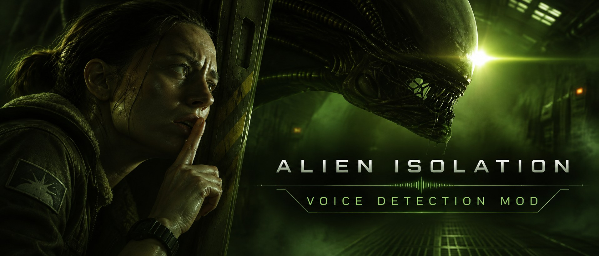
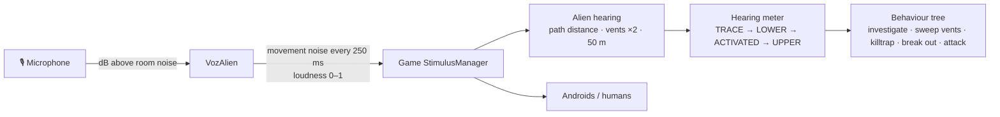

<p align="center">
  
</p>

<h1 align="center">VozAlien</h1>

<p align="center">
  <b>Voice detection for Alien: Isolation.</b><br>
  The Xenomorph hears you through your microphone — using the game's own hearing system.
</p>

<p align="center">
  <a href="https://github.com/sidnei-almeida/alien-isolation-vozalien/releases/latest"></a>
  <a href="https://github.com/sidnei-almeida/alien-isolation-vozalien/actions/workflows/build.yml"></a>
  <a href="LICENSE"></a>
  
  
</p>

<p align="center"><a href="README.pt-BR.md">🇧🇷 Leia em português</a></p>

---

Whisper and the Alien won't notice you from the other side of the room. Talk at a normal volume a few metres
away and it comes to check. Keep talking and it narrows you down. Shout while it crawls through the vents and
it drops into your area — without knowing exactly where you are.

**VozAlien turns your real voice into an in-game noise**, exactly like footsteps or the motion tracker's beep.
It never tells the Alien where you are: it makes a sound, and the game's own AI decides what the Alien heard
and what to do about it.

> In testing (Mission 5, *The Quarantine*): a single "buddy" at normal volume with the Alien about 9 m away made
> it come and search the spot where I was hiding. It didn't find me — until I stepped into it.

## Contents

- [Highlights](#highlights)
- [How it works](#how-it-works)
- [VozAlien vs. AlienIsolationVoiceRestore](#vozalien-vs-alienisolationvoicerestore)
- [Requirements](#requirements)
- [Installation](#installation)
- [First launch](#first-launch)
- [Configuration](#configuration)
- [Uninstall](#uninstall)
- [Troubleshooting](#troubleshooting)
- [Building from source](#building-from-source)
- [Credits](#credits)

## Highlights

- **Native, not forced.** Your voice is posted as a regular *movement noise* stimulus. The game computes who
  hears it — no hard-coded "the Alien now knows where you are".
- **Distance is real.** Hearing uses the walkable path length, so walls and corridors matter. Vents halve the
  range, as they do for every other sound in the game.
- **It builds up.** One word far away barely registers. Sustained talking keeps filling the Alien's hearing meter
  until it crosses the threshold that makes it investigate, search or attack.
- **Uncertain at a distance.** When the Alien is far (or in a vent), the noise comes from a nearby spot you walked
  through recently, so it heads for your *area*. Up close, it hears exactly where you are — like the tracker.
- **The AI stays free.** Killtraps from the vents, ambushes, breakouts, retreats: all still decided by the game.
- **Everyone can hear you.** Androids and hostile humans react to your voice too, just like to your footsteps.
- **Robust microphone handling.** Room-noise calibration, adaptive noise floor, mute detection with automatic
  recalibration, and a guard against fans/music being mistaken for speech.
- **Safe by design.** Every game address is byte-checked at startup (fail-closed), the hook only runs while the
  AI is simulating (nothing happens while paused), and everything is logged.
- **Small and open.** One C file, MIT licensed.

## How it works



1. **Microphone.** VozAlien measures your room noise during the first 3 seconds, then detects speech as sound that
   rises clearly above it. Short clicks and taps are ignored.
2. **Loudness.** Speech level is mapped onto the game's own loudness scale — every +6 dB doubles the reach, like
   real sound:

   | Your voice (dB above room noise) | In-game loudness | Comparable to | Reach (through vents) |
   |---|---|---|---|
   | ~8 dB — whisper | 0.07 | — | ~4 m (~2 m) |
   | ~14 dB — quiet talk | 0.15 | slow footsteps | ~8 m (~4 m) |
   | ~20 dB — normal talk | 0.30 | walking | ~15 m (~7 m) |
   | ~26 dB — loud talk | 0.60 | running | ~30 m (~15 m) |
   | 32 dB+ — shout | 1.00 | motion tracker beep | ~50 m (~25 m) |

   *dB values depend on your mic and room; a close condenser mic in a quiet room reads higher. See
   [Configuration](#configuration).*
3. **Noise.** While you speak, one stimulus is posted every 250 ms (the game posts footsteps at the same rate).
4. **The game takes over.** For each listener: `activation = loudness − distance / max_hearing_distance`, with
   `max_hearing_distance` = 50 m for the Alien and distance measured along the navigation path (straight line ×2
   if the Alien or you are in a vent). Activation is scaled by the Alien's current sense set (it hears better when
   alerted) and added to its HEARD_MOVEMENT meter, which decays over time. Crossing LOWER makes it investigate the
   noise; higher levels escalate. In vents, the backstage behaviours (area sweep, killtrap, breakout) take over.

Full details, addresses and evidence: [docs/REVERSE-ENGINEERING.md](docs/REVERSE-ENGINEERING.md).

## VozAlien vs. AlienIsolationVoiceRestore

**AlienIsolationVoiceRestore** (AIVR) by InuraFRA was the first mod to bring
microphone-driven Alien perception to PC, and it inspired this project. VozAlien is an independent
implementation (no AIVR code) built around a different idea: **make a sound, don't hand out the player's position.**

| | AIVR 1.0.0 | VozAlien |
|---|---|---|
| What reaches the game | A forced `NPC_FakeSense` event injected straight into the Alien's perception | A regular movement-noise stimulus, like footsteps |
| Certainty | Always **UPPER** (maximum) | Whatever the game's hearing model produces |
| Position given to the Alien | Your exact position, every time | Exact when close; a nearby spot you walked through when far |
| Distance | Ignored — heard anywhere on the map | Walkable path distance, 50 m hearing range |
| Loudness | Ignored — a whisper equals a scream | Mapped to the game's loudness scale (6 dB per doubling) |
| Vents | No difference | Half range, backstage behaviours decide |
| Talking longer | Same event again (with cooldown) | Fills the hearing meter progressively |
| Other NPCs | Only the Alien | Androids and humans hear you too |
| Source code | Closed | MIT |

## Requirements

- **Alien: Isolation — Steam version.** Other builds (Epic, GOG, Microsoft Store) have different code; VozAlien
  detects that and stays disabled.
- **Windows**, or **Linux with Steam + Proton**.
- A **microphone** (the system default input is used unless you pick another one in the ini).
- An **ASI loader** — [Ultimate ASI Loader](https://github.com/ThirteenAG/Ultimate-ASI-Loader). If you already use
  mods such as Alias Isolation or MouseFix you probably have it; otherwise the installers add it.

## Installation

### Linux (Steam / Proton)

```bash
curl -fsSL https://raw.githubusercontent.com/sidnei-almeida/alien-isolation-vozalien/main/install.sh | bash
```

Then make sure the game's **Launch Options** in Steam load the ASI loader (the installer prints the exact line):

```
WINEDLLOVERRIDES="d3d11=n,b" %command%
```

Already have a `WINEDLLOVERRIDES` (ReShade, DXVK tweaks…)? Add `d3d11=n,b` to it with a `;`, e.g.
`WINEDLLOVERRIDES="d3d11=n,b;dxgi=n,b" %command%`.

### Windows (PowerShell)

```powershell
irm https://raw.githubusercontent.com/sidnei-almeida/alien-isolation-vozalien/main/install.ps1 | iex
```

Windows must allow desktop apps to use the microphone: *Settings → Privacy & security → Microphone → Let desktop
apps access your microphone*.

### What the installers do

1. Find Alien: Isolation in all your Steam libraries (or use `--game-dir` / `-GameDir`).
2. Warn if `AI.exe` is not the supported Steam build.
3. Download `VozAlien.asi` and `VozAlien.ini` from the latest release.
4. Rename `AlienIsolationVoiceRestore.asi` to `.asi.disabled` if present, so the two mods don't stack.
5. Keep your existing ASI loader, or install Ultimate ASI Loader **v10.0.1** (pinned, SHA-256 verified) as
   `d3d11.dll` (or `winmm.dll` if `d3d11.dll` is taken).
6. Copy the mod next to `AI.exe`. An existing `VozAlien.ini` is never overwritten.

### Manual install

1. Download `VozAlien.asi` and `VozAlien.ini` from [Releases](https://github.com/sidnei-almeida/alien-isolation-vozalien/releases/latest).
2. Put both next to `AI.exe`.
3. Make sure an ASI loader is installed (and, on Proton, overridden as shown above).

## First launch

- **Stay quiet for ~3 seconds when the game window opens** — that's when the room noise is measured.
- Check `VozAlien.log` next to `AI.exe`. A healthy start looks like:

  ```
  VozAlien 0.2.2 loaded
  Hook on StimulusManager::Tick installed (base 7A040000). Mode: natural
  MIC open; calibrating for 3000 ms (stay quiet)
  MIC calibrated: room noise -64.1 dBFS (median -62.2)
  PLAYER found: pos=(-5.50,-3.94,57.65) handle=(B222F72F,1BF81C06)
  VOICE voice #58 A=18.0 dB -> loudness 0.24 (range ~12 m; through vents ~6 m) | alien at 3.7 m | position exact, offset 0.0 m
  ```

## Configuration

Edit `VozAlien.ini` next to `AI.exe` (changes apply on the next launch). The most useful keys:

| Section / key | Default | What it does |
|---|---|---|
| `[Voz] Loudness20dB` | `0.30` | Loudness at 20 dB above room noise. **Lower it if the Alien hears you too easily**, raise it if never. |
| `[Voz] LoudnessMax` | `1.0` | Cap for shouting. `0.7` makes a scream count like running instead of the motion tracker. |
| `[Imprecisao] Enabled` | `1` | Positional uncertainty at a distance. `0` = always your exact position. |
| `[Imprecisao] StartDistance` / `Fraction` / `Max` | `8` / `0.30` / `15` | Exact within 8 m; beyond that the offset is 30 % of the distance, at most 15 m. |
| `[Microfone] Device` | *(empty)* | Part of the microphone name to use instead of the default input. |
| `[Microfone] StartDb` / `StopDb` | `10` / `6` | How far above room noise counts as speech. |
| `[Microfone] PostMs` | `250` | Interval between noises while you speak. |
| `[Teste] Hotkeys` | `0` | `1` = F7/F8 simulate one second of normal/loud speech (testing without a mic). |
| `[Geral] Modo` | `natural` | `forcado` = fallback that hands graded certainty straight to the Alien. |
| `[Geral] LogLevel` | `1` | `2` also logs microphone levels and every utterance. |

Section and key names are in Portuguese for historical reasons; every key is commented in English in the ini.

## Uninstall

```bash
# Linux
curl -fsSL https://raw.githubusercontent.com/sidnei-almeida/alien-isolation-vozalien/main/install.sh | bash -s -- --uninstall
```

```powershell
# Windows
& ([scriptblock]::Create((irm https://raw.githubusercontent.com/sidnei-almeida/alien-isolation-vozalien/main/install.ps1))) -Uninstall
```

Or simply delete `VozAlien.asi` from the game folder. The ASI loader is left in place (other mods may use it).

## Troubleshooting

| Symptom | Cause / fix |
|---|---|
| Log says `room noise -140.0 dBFS` | The microphone sends digital silence: hardware mute button, gain at zero, or wrong default input. Fix it and restart the game (or just unmute — VozAlien recalibrates when sound comes back). |
| No `VozAlien.log` at all | The ASI loader isn't loading. On Proton check the `WINEDLLOVERRIDES` launch option. |
| `ERROR: AI.exe is not the expected build` | Not the Steam build (or the game was updated). The mod stays off by design. |
| `ERROR: ... already redirected by another mod` | Another mod hooks the same call. Please open an issue with the mod's name. |
| The Alien reacts to everything | Your mic reads hot (close condenser + quiet room). Lower `Loudness20dB` to `0.2` or `0.15`. |
| The Alien never reacts | Check that `VOICE` lines appear with `alien at …`. Raise `Loudness20dB`, or test with `Hotkeys=1`. |
| Antivirus flags the `.asi` | ASI mods are unsigned DLLs injected by a loader; build it yourself from source if in doubt. |

When reporting an issue, attach `VozAlien.log` and say where you were in the game.

## Building from source

```bash
# Arch: pacman -S mingw-w64-gcc    Debian/Ubuntu: apt install gcc-mingw-w64-i686
./build.sh            # -> dist/VozAlien.asi + dist/VozAlien.ini
./install.sh --local  # install your build into the game
```

On Windows, use an MSYS2 **MINGW32** shell (`pacman -S mingw-w64-i686-gcc`) and run `CC=gcc ./build.sh`.

## Credits

- **InuraFRA** — AlienIsolationVoiceRestore, the original idea of a microphone-aware Alien on PC.
- **ThirteenAG** — [Ultimate ASI Loader](https://github.com/ThirteenAG/Ultimate-ASI-Loader) (MIT), downloaded by the installers when needed.
- **Creative Assembly** — for shipping the Alien's behaviour trees in readable form with the game.

## Disclaimer

VozAlien is an unofficial fan modification. It is not affiliated with or endorsed by SEGA, Creative Assembly or
20th Century Studios. Alien: Isolation and all related marks belong to their respective owners. No game files are
distributed.

## License

[MIT](LICENSE) © 2026 Sidnei Alves de Almeida
