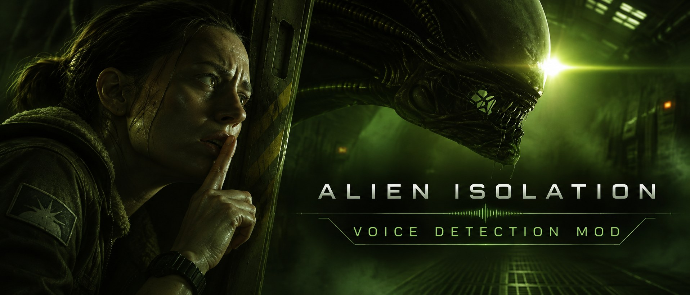
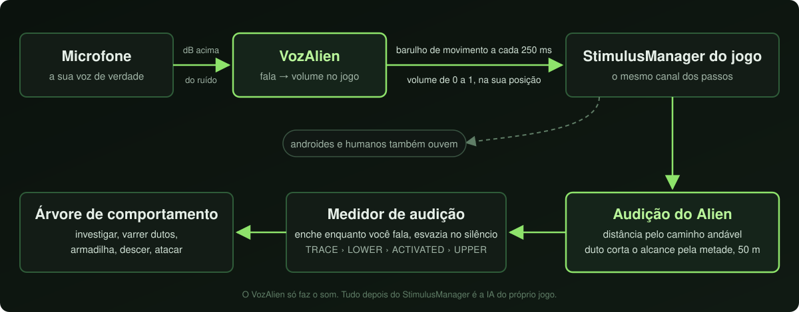

<p align="center">
  
</p>

<h1 align="center">VozAlien</h1>

<p align="center">
  <b>Detecção de voz para Alien: Isolation.</b><br>
  O Xenomorfo te ouve pelo microfone, usando o próprio sistema de audição do jogo.
</p>

<p align="center">
  <a href="https://github.com/sidnei-almeida/alien-isolation-vozalien/releases/latest"></a>
  <a href="https://github.com/sidnei-almeida/alien-isolation-vozalien/actions/workflows/build.yml"></a>
  <a href="LICENSE"></a>
  
  
</p>

<p align="center"><a href="README.md">🇺🇸 Read in English</a></p>

---

Sussurre e o Alien não te nota do outro lado da sala. Fale normal a poucos metros e ele vem conferir. Continue
falando e ele vai fechando o cerco. Grite com ele rastejando nos dutos e ele desce na sua área, sem saber
exatamente onde você está.

**O VozAlien transforma a sua voz de verdade em um barulho dentro do jogo**, igual a passos ou ao bip do
rastreador. Ele nunca conta pro Alien onde você está: ele faz um som, e a própria IA do jogo decide o que o Alien
ouviu e o que fazer com isso.

> No teste (Missão 5, *The Quarantine*): um "buddy" em volume normal, com o Alien a uns 9 m, fez ele vir procurar
> no lugar onde eu estava escondido. Ele não me achou. Aí eu esbarrei nele.

## Sumário

- [Destaques](#destaques)
- [Como funciona](#como-funciona)
- [VozAlien vs. AlienIsolationVoiceRestore](#vozalien-vs-alienisolationvoicerestore)
- [Requisitos](#requisitos)
- [Instalação](#instalação)
- [Primeira vez](#primeira-vez)
- [Configuração](#configuração)
- [Desinstalar](#desinstalar)
- [Problemas comuns](#problemas-comuns)
- [Compilar](#compilar)
- [Créditos](#créditos)

## Destaques

- **Nativo, não forçado.** A voz entra como um *barulho de movimento* comum. O jogo calcula quem ouve. Nada diz
  ao Alien onde você está.
- **A distância é real.** A audição usa o comprimento do caminho andável, então paredes e corredores contam.
  Dutos cortam o alcance pela metade, como acontece com qualquer outro som do jogo.
- **Vai acumulando.** Uma palavra solta longe quase não conta. Falar sem parar vai enchendo o medidor de audição
  do Alien até ele passar do ponto de investigar, procurar ou atacar.
- **Impreciso de longe.** Com o Alien longe (ou no duto), o barulho sai de um lugar por onde você passou há pouco,
  e ele vai pra sua *área*. De perto, ele ouve exatamente onde você está, como com o rastreador.
- **A IA continua livre.** Armadilha com a baba no duto, emboscada, descer do duto, recuar: tudo decidido pelo jogo.
- **Todo mundo ouve.** Androides e humanos hostis também reagem à sua voz, como reagem aos seus passos.
- **Microfone tratado com cuidado.** Calibração do ruído do quarto, ruído de fundo adaptativo, detecção de
  microfone mudo com recalibração automática e proteção contra ventilador/música serem confundidos com fala.
- **Seguro.** Todos os endereços do jogo são conferidos byte a byte na abertura (se não bater, desliga), o gancho
  só roda com a IA ativa (nada acontece com o jogo pausado) e tudo vai pro log.
- **Pequeno e aberto.** Um arquivo C, licença MIT.

## Como funciona

<p align="center">
  
</p>

1. **Microfone.** O VozAlien mede o ruído do seu quarto nos primeiros 3 segundos e depois detecta fala como o som
   que sobe bem acima disso. Cliques e batidinhas curtas são ignorados.
2. **Volume.** O nível da fala é convertido para a régua de volume do próprio jogo. Cada +6 dB dobra o alcance,
   como acontece com o som de verdade:

   | Sua voz (dB acima do ruído do quarto) | Volume no jogo | Parecido com | Alcance (pelo duto) |
   |---|---|---|---|
   | ~8 dB, sussurro | 0,07 | | ~4 m (~2 m) |
   | ~14 dB, fala baixa | 0,15 | passos devagar | ~8 m (~4 m) |
   | ~20 dB, fala normal | 0,30 | andando | ~15 m (~7 m) |
   | ~26 dB, falando alto | 0,60 | correndo | ~30 m (~15 m) |
   | 32 dB+, grito | 1,00 | bip do rastreador | ~50 m (~25 m) |

   *Os dB dependem do microfone e do quarto; um condensador perto da boca num quarto silencioso marca mais alto.
   Veja [Configuração](#configuração).*
3. **Barulho.** Enquanto você fala, um estímulo é publicado a cada 250 ms (o jogo publica os passos no mesmo ritmo).
4. **O jogo assume.** Para cada personagem: `ativação = volume − distância / alcance_de_audição`, com alcance de
   50 m para o Alien e distância medida pelo caminho de navegação (linha reta ×2 se ele ou você estiver no duto).
   A ativação é escalada pelo estado de alerta dele (ele ouve melhor quando está atento) e somada ao medidor
   HEARD_MOVEMENT, que esvazia com o tempo. Passar de LOWER faz ele ir investigar o barulho; os níveis acima
   escalam. No duto, quem decide são os comportamentos de bastidor (varredura, armadilha, descer).

Detalhes completos, endereços e evidências (em inglês): [docs/REVERSE-ENGINEERING.md](docs/REVERSE-ENGINEERING.md).

## VozAlien vs. AlienIsolationVoiceRestore

O **AlienIsolationVoiceRestore** (AIVR), do InuraFRA, foi o primeiro mod a trazer a percepção do Alien pelo
microfone para o PC e inspirou este projeto. O VozAlien é uma implementação independente (nenhum código do AIVR)
com outra ideia central: **fazer um som, não entregar a posição do jogador.**

| | AIVR 1.0.0 | VozAlien |
|---|---|---|
| O que chega no jogo | Um evento `NPC_FakeSense` forçado, direto na percepção do Alien | Um estímulo de barulho comum, como passos |
| Certeza | Sempre **UPPER** (máxima) | O que o modelo de audição do jogo produzir |
| Posição entregue ao Alien | A sua posição exata, sempre | Exata de perto; um lugar por onde você passou, de longe |
| Distância | Ignorada: ouve de qualquer lugar do mapa | Distância pelo caminho, alcance de 50 m |
| Volume | Ignorado: sussurro vale o mesmo que grito | Na régua do jogo (6 dB dobram o alcance) |
| Dutos | Sem diferença | Metade do alcance; comportamentos de duto decidem |
| Falar por mais tempo | O mesmo evento de novo (com intervalo) | Enche o medidor aos poucos |
| Outros NPCs | Só o Alien | Androides e humanos também ouvem |
| Código-fonte | Fechado | MIT |

## Requisitos

- **Alien: Isolation, versão Steam.** Outras versões (Epic, GOG, Microsoft Store) têm código diferente; o VozAlien
  percebe e fica desligado.
- **Windows**, ou **Linux com Steam + Proton**.
- Um **microfone** (usa a entrada padrão do sistema, a não ser que você escolha outra no ini).
- Um **ASI loader**: [Ultimate ASI Loader](https://github.com/ThirteenAG/Ultimate-ASI-Loader). Se você já usa mods
  como Alias Isolation ou MouseFix, provavelmente já tem; senão, os instaladores colocam.

## Instalação

### Linux (Steam / Proton)

```bash
curl -fsSL https://raw.githubusercontent.com/sidnei-almeida/alien-isolation-vozalien/main/install.sh | bash
```

Depois confira se as **Opções de inicialização** do jogo na Steam carregam o ASI loader (o instalador mostra a
linha exata):

```
WINEDLLOVERRIDES="d3d11=n,b" %command%
```

Já tem um `WINEDLLOVERRIDES` (ReShade, ajustes do DXVK…)? Acrescente `d3d11=n,b` com `;`, por exemplo
`WINEDLLOVERRIDES="d3d11=n,b;dxgi=n,b" %command%`.

### Windows (PowerShell)

```powershell
irm https://raw.githubusercontent.com/sidnei-almeida/alien-isolation-vozalien/main/install.ps1 | iex
```

O Windows precisa permitir que aplicativos da área de trabalho usem o microfone: *Configurações → Privacidade e
segurança → Microfone → Permitir que aplicativos da área de trabalho acessem o microfone*.

### O que os instaladores fazem

1. Acham o Alien: Isolation em todas as suas bibliotecas da Steam (ou usam `--game-dir` / `-GameDir`).
2. Avisam se o `AI.exe` não for a versão Steam suportada.
3. Baixam `VozAlien.asi` e `VozAlien.ini` da release mais recente.
4. Renomeiam `AlienIsolationVoiceRestore.asi` para `.asi.disabled`, se existir, para os dois mods não somarem.
5. Mantêm o seu ASI loader, ou instalam o Ultimate ASI Loader **v10.0.1** (versão fixa, SHA-256 conferido) como
   `d3d11.dll` (ou `winmm.dll` se o `d3d11.dll` já estiver em uso).
6. Copiam o mod para o lado do `AI.exe`. Um `VozAlien.ini` existente nunca é sobrescrito.

### Instalação manual

1. Baixe `VozAlien.asi` e `VozAlien.ini` em [Releases](https://github.com/sidnei-almeida/alien-isolation-vozalien/releases/latest).
2. Coloque os dois ao lado do `AI.exe`.
3. Garanta um ASI loader instalado (e, no Proton, a opção de inicialização acima).

## Primeira vez

- **Fique quieto uns 3 segundos quando a janela do jogo abrir.** É nessa hora que o ruído do quarto é medido.
- Confira o `VozAlien.log` ao lado do `AI.exe`. Um começo saudável:

  ```
  VozAlien 0.2.2 loaded
  Hook on StimulusManager::Tick installed (base 7A040000). Mode: natural
  MIC open; calibrating for 3000 ms (stay quiet)
  MIC calibrated: room noise -64.1 dBFS (median -62.2)
  PLAYER found: pos=(-5.50,-3.94,57.65) handle=(B222F72F,1BF81C06)
  VOICE voice #58 A=18.0 dB -> loudness 0.24 (range ~12 m; through vents ~6 m) | alien at 3.7 m | position exact, offset 0.0 m
  ```

## Configuração

Edite o `VozAlien.ini` ao lado do `AI.exe` (vale a partir da próxima abertura). As chaves mais úteis:

| Seção / chave | Padrão | O que faz |
|---|---|---|
| `[Voz] Loudness20dB` | `0.30` | Volume com 20 dB acima do ruído do quarto. **Baixe se o Alien te ouvir fácil demais**, suba se nunca ouvir. |
| `[Voz] LoudnessMax` | `1.0` | Teto do grito. `0.7` faz um grito valer como correr em vez do rastreador. |
| `[Imprecisao] Enabled` | `1` | Imprecisão da posição de longe. `0` = sempre a sua posição exata. |
| `[Imprecisao] StartDistance` / `Fraction` / `Max` | `8` / `0.30` / `15` | Exato até 8 m; depois o erro é 30 % da distância, no máximo 15 m. |
| `[Microfone] Device` | *(vazio)* | Parte do nome do microfone, se não for a entrada padrão. |
| `[Microfone] StartDb` / `StopDb` | `10` / `6` | Quanto acima do ruído do quarto conta como fala. |
| `[Microfone] PostMs` | `250` | Intervalo entre barulhos enquanto você fala. |
| `[Teste] Hotkeys` | `0` | `1` = F7/F8 simulam um segundo de fala normal/alta (testar sem microfone). |
| `[Geral] Modo` | `natural` | `forcado` = modo reserva que entrega a certeza graduada direto pro Alien. |
| `[Geral] LogLevel` | `1` | `2` também registra o nível do microfone e cada fala. |

## Desinstalar

```bash
# Linux
curl -fsSL https://raw.githubusercontent.com/sidnei-almeida/alien-isolation-vozalien/main/install.sh | bash -s -- --uninstall
```

```powershell
# Windows
& ([scriptblock]::Create((irm https://raw.githubusercontent.com/sidnei-almeida/alien-isolation-vozalien/main/install.ps1))) -Uninstall
```

Ou apague o `VozAlien.asi` da pasta do jogo. O ASI loader fica (outros mods podem usar).

## Problemas comuns

| Sintoma | Causa / solução |
|---|---|
| O log diz `room noise -140.0 dBFS` | O microfone está mandando silêncio digital: botão de mudo, ganho no zero ou entrada padrão errada. Corrija e reabra o jogo (ou só desmute: o VozAlien recalibra quando o som volta). |
| Não aparece `VozAlien.log` | O ASI loader não está carregando. No Proton, confira o `WINEDLLOVERRIDES` nas opções de inicialização. |
| `ERROR: AI.exe is not the expected build` | Não é a versão Steam (ou o jogo foi atualizado). O mod fica desligado de propósito. |
| `ERROR: ... already redirected by another mod` | Outro mod usa o mesmo gancho. Abra uma issue com o nome do mod. |
| O Alien reage a tudo | Seu microfone marca alto (condensador perto + quarto silencioso). Baixe `Loudness20dB` para `0.2` ou `0.15`. |
| O Alien nunca reage | Veja se aparecem linhas `VOICE` com `alien at …`. Suba `Loudness20dB` ou teste com `Hotkeys=1`. |
| O antivírus reclama do `.asi` | Mods ASI são DLLs sem assinatura carregadas por um loader; na dúvida, compile você mesmo. |

Ao reportar um problema, anexe o `VozAlien.log` e diga em que parte do jogo você estava.

## Compilar

```bash
# Arch: pacman -S mingw-w64-gcc    Debian/Ubuntu: apt install gcc-mingw-w64-i686
./build.sh            # -> dist/VozAlien.asi + dist/VozAlien.ini
./install.sh --local  # instala a sua build no jogo
```

No Windows, use um shell **MINGW32** do MSYS2 (`pacman -S mingw-w64-i686-gcc`) e rode `CC=gcc ./build.sh`.

## Créditos

- **InuraFRA**: AlienIsolationVoiceRestore, a ideia original de um Alien que ouve o microfone no PC.
- **ThirteenAG**: [Ultimate ASI Loader](https://github.com/ThirteenAG/Ultimate-ASI-Loader) (MIT), baixado pelos instaladores quando necessário.
- **Creative Assembly**, por distribuir as árvores de comportamento do Alien em formato legível junto com o jogo.

## Aviso

O VozAlien é uma modificação de fã, não oficial. Não tem afiliação nem endosso da SEGA, da Creative Assembly ou da
20th Century Studios. Alien: Isolation e marcas relacionadas pertencem aos seus donos. Nenhum arquivo do jogo é
distribuído.

## Licença

[MIT](LICENSE) © 2026 Sidnei Alves de Almeida
