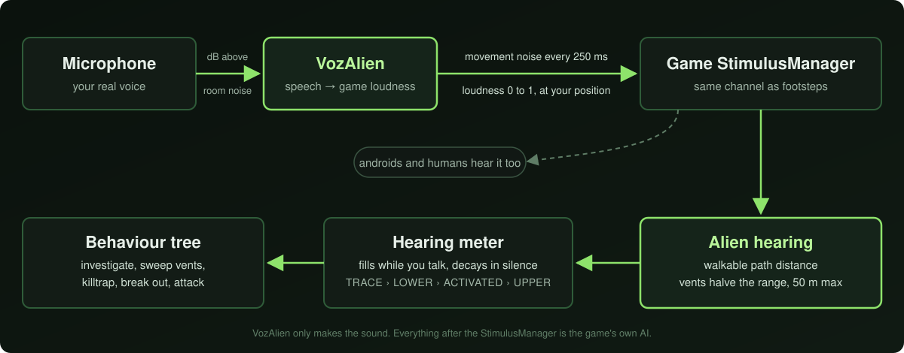

<h1 align="center">How Alien: Isolation hears you</h1>

<p align="center">
  <b>A contributor's guide to the game systems behind VozAlien</b><br>
  Reverse-engineered from the Steam <code>AI.exe</code> and the behaviour trees shipped with the game.
</p>

<p align="center"><a href="REVERSE-ENGINEERING.pt-BR.md">🇧🇷 Leia em português</a> · <a href="../README.md">Back to the README</a></p>

---

This document explains, step by step, how the game turns a sound into an Alien reaction, and exactly where
VozAlien plugs into that chain. It is written for people who want to improve the mod, port it to another build of
the game, or simply understand what is going on. You don't need to read the source first: every section points to
the relevant function in [`src/voz_alien.c`](../src/voz_alien.c).

> [!NOTE]
> Everything here was obtained by static analysis of the **Steam** build of `AI.exe` (32-bit,
> SHA-256 `dde66521798aae8c39ed4e7a3400f561fcecfff83619d1426b9e0cedf5819a90`) and confirmed in game through the
> mod's log. Other builds (Epic, GOG, Microsoft Store) have the same systems at different addresses.

## Contents

1. [The big picture](#1-the-big-picture)
2. [Conventions](#2-conventions)
3. [Method: how to find things yourself](#3-method-how-to-find-things-yourself)
4. [Finding characters in memory](#4-finding-characters-in-memory)
5. [The stimulus system](#5-the-stimulus-system)
6. [How a character hears a stimulus](#6-how-a-character-hears-a-stimulus)
7. [Vents (backstage)](#7-vents-backstage)
8. [The forced path: NPC_FakeSense](#8-the-forced-path-npc_fakesense)
9. [Behaviour trees: what the Alien does with it](#9-behaviour-trees-what-the-alien-does-with-it)
10. [How VozAlien puts it together](#10-how-vozalien-puts-it-together)
11. [Safety and porting to other builds](#11-safety-and-porting-to-other-builds)
12. [Open questions: good first contributions](#12-open-questions-good-first-contributions)
13. [Address reference](#13-address-reference)
14. [Glossary](#14-glossary)

---

## 1. The big picture

<p align="center">
  
</p>

Alien: Isolation has two independent layers of AI:

| Layer | What it does | Where it lives |
|---|---|---|
| **Senses** | Every AI character keeps a *meter* per sense (sight, movement sounds, combat sounds…). Stimuli fill the meters; time drains them. | C++ code in `AI.exe` |
| **Decisions** | A behaviour tree reads the meters (and timers, flags, motivations) and picks an action: investigate, search, ambush, attack. | Brainiac XML in `DATA/BEHAVIOR`, compiled to `DATA/BINARY_BEHAVIOR` |

Footsteps, the motion tracker and gunfire never talk to the behaviour tree directly. They publish a **stimulus**
into a global queue, and each character decides on its own whether it heard it. VozAlien does exactly the same with
your voice. That single design choice is what makes the mod feel native.

## 2. Conventions

**Addresses.** The executable's preferred image base is `0x400000`. Addresses written like `0x7A5310` are
*virtual addresses* (VA), as they appear in a disassembler. At runtime the image is relocated (under Proton it loads
at `0x7A040000`), so code must use **RVAs**: `RVA = VA − 0x400000`, then `runtime = module base + RVA`.

**Calling convention.** Game methods are MSVC `__thiscall`: `this` in `ECX`, arguments on the stack, and the callee
cleans the stack. `ret 0x1C` means the function pops 0x1C bytes (seven 4-byte arguments). In GCC you declare them
with `__attribute__((thiscall))`.

**Confidence.** Each finding carries a tag:

| Tag | Meaning |
|---|---|
| ✅ | Confirmed by reading the disassembly (and, where noted, observed in game) |
| 🟨 | Likely: strong evidence, some inference |
| ❔ | Guess: plausible, not verified |

## 3. Method: how to find things yourself

No commercial tools are needed. Everything in this document was found with `objdump`, `strings`, a bit of Python,
and the game's own data files.

**Disassemble once, grep forever.**

```bash
objdump -d -M intel AI.exe > ai.asm          # ~5 million lines, Intel syntax
grep -n "call   0x4ab520" ai.asm               # who calls a function?
grep -n "0x16f0c88" ai.asm | head              # who reads a global?
```

**Map file offsets to addresses.** `strings -t x` prints file offsets. Convert them with the section table
(`objdump -h AI.exe`):

| Section | VA start | File offset start | Conversion |
|---|---|---|---|
| `.text` | `0x401000` | `0x400` | `VA = offset + 0x400C00` |
| `.rdata` | `0x119F000` | `0xD9D600` | `VA = offset + 0x401A00` |
| `.data` | `0x1636000` | `0x1233C00` | `VA = offset + 0x402400` |

```bash
strings -t x -n 4 AI.exe | grep -w THRESHOLD_QUALIFIER   # offset f0c59c -> VA 0x130DF9C
grep -n "0x130df9c" ai.asm                                # code that uses that string
```

**Follow the names.** The engine (CATHODE) registers its enums and entity types by name, so strings like
`NPC_FakeSense`, `UPPER_THRESHOLD` or `CONDITION_IS_BACKSTAGE` lead straight to the code that uses them. RTTI names
such as `.?AVNPC_FakeSense@CATHODE@@` identify classes and their vtables.

**Read the data.** Character tuning lives in `DATA/CHR_INFO/ATTRIBUTES/*.BML` (binary XML: hearing distances,
thresholds, footstep loudness). The Alien's decision logic ships as readable XML in `DATA/BEHAVIOR/`.

**Verify in game.** Static analysis tells you what the code *can* do; the log tells you what it *did*. Set
`LogLevel=2` and `Hotkeys=1` in `VozAlien.ini` to get repeatable tests (F7 and F8 simulate speech).

## 4. Finding characters in memory

Everything starts at one global pointer, the **world root**.

```c
uint8_t *world = *(uint8_t **)(base + 0x12F0C88);    // VA 0x16F0C88
uint8_t *chars = *(uint8_t **)(world + 0x08);        // character manager
// list A: array at chars+0x80, count at chars+0x84
// list B: array at chars+0xD0, count at chars+0xD4
```

| What | Where | |
|---|---|---|
| Character manager | `*(world + 0x08)`; the getter at `0x78A770` walks list A, then list B | ✅ |
| StimulusManager | `*(world + 0x18)` | ✅ |
| Character class | `*(int *)(*(uint8_t **)(chr + 0x64) + 4)`: 0 player, 1 Alien (read at `0x5192D9`) | ✅ |
| Handle (entity id) | 8 bytes at `chr + 0x54` (`Character::GetHandle`, `0x77A2F0`) | ✅ |
| Position | `vec3` at `chr + 0x70` | ✅ observed |
| Perception (forced-event queue) | `chr + 0x3BA8` | ✅ |
| Backstage (in a vent) | `chr[0x2DA] \|\| chr[0x2DB]` (`Character::IsBackstage`, `0x77A350`) | ✅ observed |
| Attribute block | `*(chr + 0x1154)`; attribute *id* N sits at offset `0x204 + N × 4` | ✅ |
| Game clock | `double` at VA `0x16410A8`, in seconds | ✅ |

The class enum follows the engine's `CHARACTER_CLASS_COMBINATION` order: PLAYER, ALIEN, ANDROID, CIVILIAN, SECURITY,
FACEHUGGER, INNOCENT, ANDROID_HEAVY, MELEE_HUMAN.

> [!TIP]
> In VozAlien this is `scan_characters()`, run four times per second. It also records a short **trail** of the
> player's recent positions, used later for positional uncertainty.

## 5. The stimulus system

### 5.1 The stimulus object

A stimulus is a small object. There is a base version (0x34 bytes, vtable `0x11C7190`) and an extended one
(0x3C bytes, vtable `0x11C71B0`) with six extra flag bytes. ✅

| Offset | Type | Meaning |
|---|---|---|
| `+0x00` | ptr | vtable |
| `+0x04` | `u32[2]` | "already processed" bitset, one bit per listener slot |
| `+0x0C` | int | **type** (see below) |
| `+0x10` | u32 | frame stamp written by the manager |
| `+0x14` | ptr | next stimulus of the same type |
| `+0x18` | vec3 | world position |
| `+0x24` | float | game time |
| `+0x28` | `u32[2]` | source handle (who made the noise) |
| `+0x30` | float | **loudness**, 0 to 1 in practice |
| `+0x34` | `u8[6]` | flags (extended only, see §7) |
| `+0x3A` | u8 | extra flag (extended only, meaning unknown) |

> [!IMPORTANT]
> A type 0 stimulus **must** be the extended version. The handler reads the flag bytes at `+0x34` to `+0x36`; with
> a base object those bytes are heap garbage.

### 5.2 Stimulus types

| Type | Meaning | Who produces it | Feeds |
|---|---|---|---|
| **0** | Movement noise | Footsteps `0x7C71B0` (every 0.25 s, loudness from `footstep_loudness_*`), motion tracker beep `0x682D90` (0.75 or 1.0, up to 20 per second), vent enter/exit `0x460D20` (0.4) 🟨 | HEARD_MOVEMENT |
| **1** | Weapon sound | `Weapon_AINotifier` `0x578010` (1.0, or 0.6 for one weapon type) and other weapon code | HEARD_COMBAT |
| **2** | Proximity "scanner" event | `0x5781A0` | a forced movement level inside a 2D radius |
| **3 to 5** | Not handled per character | type 4 is a bullet impact, consumed by human squads | |
| **6** | "Player was here" hint | the `Door` entity, `0x4E30E0` | writes the player's last known position straight into each NPC's memory, no meter |

For reference, the player's footstep loudness ranges from **0.2** (slow) to **0.6** (running), straight from
`DATA/CHR_INFO/ATTRIBUTES/THE_PLAYER.BML`. VozAlien maps your voice onto this same scale.

### 5.3 Posting a stimulus

```c
typedef void *(THISCALL *stim_ctor_t)(void *self, int type, const float *pos, float time,
                                      const void *handle, float loudness, const uint8_t *flags6, int extra);
typedef void  (THISCALL *stim_add_t)(void *mgr, const void *stim, int replaceSameType);

uint8_t stim[0x40];
static const uint8_t flags[6] = {0};
ctor(stim, 0, &pos.x, (float)*gameClock, player + 0x54, loudness, flags, 0);   // VA 0x4468B0, ret 0x1C
add(stimulusManager, stim, 0);                                                    // VA 0x4574D0, ret 0x08
```

* `AddExtended` copies the object into a pool node, stamps it and appends it to the list for its type, so your
  buffer can live on the stack. ✅
* `replaceSameType = 1` would free **every** queued stimulus of that type first. The game always passes 0. ✅
* The base variants are `0x446850` (ctor, ret 0x14) and `0x5772F0` (add). ✅

### 5.4 Lifetime and the tick

`StimulusManager::Tick` (`0x7A5310`, thiscall, no arguments) increments the manager's frame counter and frees every
stimulus that is two or more ticks old. Each listener therefore sees each stimulus exactly once. ✅

The tick is called from a single place, `0x7B41A3`, and only while the world is simulating
(`([[0x16F194C] + 4] & 0x179FF) == 0`), not while the game is paused or loading. 🟨 That makes this call site the
ideal hook: VozAlien redirects it, calls the original, then posts its own stimulus.

## 6. How a character hears a stimulus

### 6.1 Who gets to listen

Each AI character owns a *Brain* (built at `0x733850`). At `brain + 0xF4` sits its **SenseProcessor** (0xC8 bytes,
ctor `0x72D7B0`), which embeds a stimulus listener at `+0x5C`. On init the listener registers with the manager
(`0x6EC240`, one of 56 slots) for types 0, 1, 2 and 6. ✅

Every frame: `Brain::Update` (`0x7342A0`) calls `SenseProcessor::Update` (`0x7325E0`), which calls
`StimulusManager::Dispatch` (`0x6D8FB0`). Dispatch hands each new stimulus to `OnStimulus` (`0x730C30`). There is
**no spatial pre-filter**: every listener evaluates every stimulus. ✅

### 6.2 The gates in `OnStimulus`

Before any maths, a stimulus is dropped when: ✅

* the source handle doesn't resolve to a live entity, or the source is the listener itself;
* the source isn't hostile or relevant to the listener (faction table at `[world + 0x34]`). This is why friendly
  characters ignore you;
* (type 0 only) one of the flags says so, or the listener is a backstage Alien and the source isn't the player (§7).

### 6.3 Distance and activation

`Hearing::Activation` (`0x6D7CD0`, `ecx = listener + 0x33E0`) computes the raw activation: ✅

```
maxD = GetMaxHearingDistance(listener)        // 0x775F10, depends on the current sense set, at least 5 m
d    = path length along the navmesh           // never less than the straight-line distance
       (straight line x 2 if the listener or the source is backstage)
raw  = max(0, loudness - d / maxD)
```

So loudness **1.0 is audible up to `maxD`** and fades linearly. For the Alien `maxD` is **50 m** in every sense set
(`ALIEN.BML` and `DEFAULTS.BML`). A failed path query falls back to the straight-line distance; an unreachable
target is inaudible. 🟨

### 6.4 Filling the meter

`raw` is then scaled per listener (`0x6FB2E0`): ✅

```
scaled = (min_raw + raw * (max_raw - min_raw)) * activation_scalar
```

and added to the HEARD_MOVEMENT slot of the listener's memory record for that source (`0x729120`):
`act = min(1, act + scaled)`. Every threshold the meter crosses stores the **exact** stimulus position and time, and
notifies the character. ✅

The Alien's values (sense set 1 is "normal"; the heightened variant applies while it is alert):

| Attribute | Value | Source |
|---|---|---|
| `max_hearing_distance` | 50 m | `DEFAULTS.BML`, `ALIEN.BML` |
| `movement_sound_activation_scalar` | 0.7 normal, 1.25 heightened, 0.3 set 2, 2.5 set 3 | `ALIEN.BML` |
| `movement_sound_trace / lower / activation / upper_threshold` | 0.05 / 0.375 / 0.75 / 0.875 | `DEFAULTS.BML` |
| `movement_sound_decay_per_second` | 0.05 | `DEFAULTS.BML` |

**Worked example.** You talk at loudness 0.24 with the Alien 3.7 m away, in its normal sense set:
`raw = 0.24 − 3.7/50 ≈ 0.17`, so `scaled ≈ 0.17 × 0.7 ≈ 0.12` per stimulus. Five stimuli (about 1.25 s of talking)
bring the meter to roughly 0.6: past LOWER, short of ACTIVATED. The Alien goes to check where the noise came from,
which is what we observed in game.

> [!NOTE]
> Where `decay_per_second` and `positional_accuracy_scalar` are applied was not located yet (§12). The stored
> position is exact, so accuracy is probably applied later, when the Alien picks a search point.

## 7. Vents (backstage)

The game calls the vent network **backstage**. A character's state is two bytes: `0x2DA` (fully in) and `0x2DB`
(entering). `0x77A350` returns either of them; the behaviour-tree node `ConditionIsBackstage` calls exactly this. ✅

How vents change hearing (type 0, all ✅):

| Situation | Distance used |
|---|---|
| Nobody in a vent | Navmesh path length |
| Listener **or** source backstage | Straight line × 2 (sound carries half as far) |
| Alien listener, player source, flag `+0x35` set | Straight line × 1 (no vent penalty) |

Flag `+0x34` makes a sound **inaudible to a backstage Alien**. The motion tracker sets it, which is why the Alien in
the vents can't hear your tracker. A backstage Alien also ignores movement noise from anyone but the player.
VozAlien posts all flags as zero, which gives the natural vent behaviour.

> [!TIP]
> The strings `ALIEN_HEARD_BACKSTAGE` and `HEARD_BS_ALIEN` look relevant, but they are dialogue and group enums:
> human NPCs reacting to hearing the Alien in the vents. They are not an input to the Alien's hearing. 🟨

## 8. The forced path: NPC_FakeSense

Level scripts sometimes need the Alien to "notice" something no matter what. For that the engine has the CATHODE
entity `NPC_FakeSense` (parameters `SensedObject`, `FakePosition`, `Sense`, `ForceThreshold`). ✅

* The handler around `0x4E3540` switches on `SENSORY_TYPE` 0 to 4 and builds kinds 9 to 13 (VISUAL 9,
  WEAPON_SOUND 10, **MOVEMENT_SOUND 11**, DAMAGE_CAUSED 12, TOUCHED 13).
* Event ctor `0x4AB520` (ret 0x24): `(kind, handle.lo, handle.hi, pos*, 1.0f, 0, threshold, time, 0.03125f)`.
* It is delivered by `EnqueueSenseEvent` (`0x4E1C20`, `this = chr + 0x3BA8`), straight into **one** character's
  perception.
* Threshold values (name to value at `0x6C70DE`): **TRACE 0, LOWER 1, ACTIVATED 2, UPPER 3**.

This path skips distance, hearing range, vents and the meter entirely. The original AlienIsolationVoiceRestore mod
uses it with threshold UPPER and the player's exact position for every utterance, which is why it feels like a
ping. VozAlien keeps a graded version as a fallback (`Modo=forcado`), but the default is the natural stimulus path.

## 9. Behaviour trees: what the Alien does with it

Open `DATA/BEHAVIOR/ALIEN_BEHAVE.XML` in any editor. The root is a priority selector that picks a branch by
**motivation**; motivations are computed in code from the sense meters and timers. Conditions read the meters
directly:

```xml
<Node Class="LegendPlugin.Nodes.ConditionIsSenseActivationAbove"
      MustBeTriggered="True" SenseType="HEARD_MOVEMENT:3" ThresholdQualifier="LOWER_THRESHOLD:1">
```

The branches that matter for a voice mod:

| File | When | What happens |
|---|---|---|
| `ALIEN_SUSPECT_TARGET_RESPONSE.XML` | A sense newly crosses **LOWER**, the Alien is **not** in a vent, and 30 s have passed since the last response | `ActionSuspectTargetResponse`: go and check the sensed position |
| `ALIEN_THREAT_AWARE.XML` | The player holds a weapon the Alien is wary of (the flamethrower) | Keeps its distance, approaches carefully, may flank through a vent |
| `ALIEN_BACKSTAGE_STALK.XML` | The Alien is in the vents | `ActionBackstageAreaSweep` (BACKSTAGE_ONLY, or ALLOW_KILLTRAP for the drool trap) |
| `ALIEN_IN_VENT.XML`, `ALIEN_BREAKOUT.XML` | The player or the Alien is in a vent | Vent attacks; `SHOULD_BREAKOUT` makes it drop out of the vent |

The key point for contributors: **a stimulus never forces an action.** It only feeds the meters, and the tree keeps
every option it had (ambush, killtrap, retreat). VozAlien is built to preserve that.

## 10. How VozAlien puts it together

| Step | Function in `src/voz_alien.c` | What it does |
|---|---|---|
| Load | `DllMain`, then `install()` | Reads `VozAlien.ini`, byte-checks every address, redirects the call at `0x7B41A3` to `tick_hook` |
| Microphone | `mic_thread()` | `waveIn` at 16 kHz; room-noise calibration (30th percentile over 3 s); adaptive floor; speech detection with attack and release; mute detection; one *voice packet* per 250 ms of speech |
| Game tick | `tick_hook()`, then `game_tick()` | Runs inside `StimulusManager::Tick`, on the game thread, only while the AI simulates |
| World state | `scan_characters()`, `trail_update()` | Player, Aliens, vent flags, recent trail |
| Sound | `post_voice()` | `loudness = 0.30 × 2^((dB − 20) / 6)`, capped at 1.0; picks the position; posts a type 0 extended stimulus |
| Uncertainty | `fuzz_point()` | Alien farther than 8 m (× 2 in a vent): a trail point at 30 % of the distance (15 m at most), never closer to the Alien than you |
| Fallback | `forced_eval()` | Graded NPC_FakeSense events (`Modo=forcado`) |

Why double the loudness every 6 dB? Sound pressure drops by about 6 dB each time the distance doubles, and the
game's audibility is linear in distance (`loudness − d/50`). Doubling the loudness every 6 dB makes "how far away
you can be heard" behave like real sound.

## 11. Safety and porting to other builds

`install()` refuses to patch anything unless all of these match (`??` marks relocated address bytes):

| Name | RVA | Expected bytes |
|---|---|---|
| ExtStimulus ctor | `0x0468B0` | `8B C1 8B 4C 24 04 66 0F EF C0 66 0F D6 40 04 89 48 0C` |
| AddExtended | `0x0574D0` | `6A FF 68 ?? ?? ?? ?? 64 A1 00 00 00 00 50 64 89 25 00 00 00 00 83 EC 3C 8B 44 24 4C 56 8B F1` |
| StimulusManager::Tick | `0x3A5310` | `83 EC 0C FF 41 20 53 55 8D 41 04` |
| Tick call site | `0x3B419E` | `8B 49 18 56 57 E8` (and the call must still point at the tick) |
| FakeSense ctor | `0x0AB520` | `8B 54 24 04 8B C1 F3 0F 10 44 24 14 33 C9 89 48 04` |
| EnqueueSenseEvent | `0x0E1C20` | `6A FF 68 ?? ?? ?? ?? 64 A1 00 00 00 00 50 64 89 25 00 00 00 00 83 EC 3C` |
| Character getter | `0x38A770` | `A1 ?? ?? ?? ?? 8B 48 08 8B 91 84 00 00 00 8B 44 24 04 3B C2` |

**Porting to Epic or GOG** means finding the same functions in that executable. Search for these byte patterns
(they contain no absolute addresses outside the `??` parts), confirm each hit by its callers, and replace the RVAs.
The struct offsets (`+0x54`, `+0x70`, `+0x2DA`, `+0x3BA8`) are very likely the same across builds. A pull request
that adds a table of builds, selected by the executable's hash, would be very welcome.

## 12. Open questions: good first contributions

* **Decay and positional accuracy.** Where are `decay_per_second` and `positional_accuracy_scalar` applied? If the
  game already blurs the search point, VozAlien's own uncertainty layer could be reduced or made optional.
* **How backstage sweeps pick a target.** `BackstageAreaSweep` (factory `0x6ED630`) and `BackstageAlienResponse`
  (`0x6F6CA0`) choose where the Alien goes in the vents. Knowing their inputs would let us predict the "far vent
  versus near vent" behaviour precisely.
* **Hiding.** `hiding_hearing_range` (attribute `0x207`) probably reduces how well a hidden player is heard. Can the
  player's hiding state be read, and should talking from a locker be quieter?
* **A debug overlay.** Reading the Alien's HEARD_MOVEMENT meter for the player would make tuning much easier than
  watching behaviour.
* **More builds.** See §11.
* **English INI keys.** Section and key names are still Portuguese (`[Voz]`, `[Imprecisao]`); a backwards-compatible
  rename would help international users.

## 13. Address reference

All values are VAs (subtract `0x400000` for RVAs).

| VA | Name | Notes | |
|---|---|---|---|
| `0x16F0C88` | World root (global) | `+0x08` characters, `+0x18` StimulusManager, `+0x34` factions | ✅ |
| `0x78A770` | Character getter | lists at `+0x80/+0x84` and `+0xD0/+0xD4` | ✅ |
| `0x77A2F0` | `Character::GetHandle` | `lea eax, [ecx+0x54]` | ✅ |
| `0x77A350` | `Character::IsBackstage` | `[0x2DA] \|\| [0x2DB]` | ✅ |
| `0x78B140` | `Character::SetBackstage` | writes `0x2DA` and `0x2D9` | ✅ |
| `0x16410A8` | Game clock | `double`, seconds | ✅ |
| `0x4468B0` | `ExtStimulus` ctor | ret 0x1C | ✅ |
| `0x446850` | `BaseStimulus` ctor | ret 0x14 | ✅ |
| `0x4574D0` | `StimulusManager::AddExtended` | ret 0x08 | ✅ |
| `0x5772F0` | `StimulusManager::AddBase` | ret 0x08 | ✅ |
| `0x7A5310` | `StimulusManager::Tick` | frees stimuli after 2 ticks | ✅ |
| `0x7B41A3` | Call to the tick | VozAlien's hook point | ✅ |
| `0x6EC240` | `StimulusManager::RegisterListener` | 56 slots | ✅ |
| `0x6D8FB0` | `StimulusManager::Dispatch` | types 0 to 6 | ✅ |
| `0x730C30` | `SenseProcessor::OnStimulus` | gates and distance mode | ✅ |
| `0x6D7CD0` | `Hearing::Activation` | `max(0, loudness − d/maxD)` | ✅ |
| `0x775F10` | `Character::GetMaxHearingDistance` | per sense set, at least 5 m | ✅ |
| `0x6FB2E0` | `SenseSlot::Scale` | min/max raw, activation scalar | ✅ |
| `0x729120` | `SenseSlot::Add` | meter, thresholds, stored position | ✅ |
| `0x7C71B0` | Footsteps | type 0 producer | ✅ |
| `0x682D90` | Motion tracker beep | type 0 producer, flags `{1,0,0,0,0,0}` | ✅ |
| `0x578010` | `Weapon_AINotifier` | type 1 producer | ✅ |
| `0x4E30E0` | `Door` "player was here" | type 6 producer | ✅ |
| `0x4AB520` | Forced sense event ctor | NPC_FakeSense | ✅ |
| `0x4E1C20` | `EnqueueSenseEvent` | `this = chr + 0x3BA8` | ✅ |
| `0x6C70DE` | Threshold name to value | TRACE 0 to UPPER 3 | ✅ |
| `0x774FA0` | `START_NEXT_FRAME` task | alternative per-frame hook | ✅ |
| `0x12B4B00` | Menace manager vtable | does not route sounds | 🟨 |
| `0x6ED630` | `BackstageAreaSweep` factory | target choice not traced | ❔ |

## 14. Glossary

| Term | Meaning |
|---|---|
| **VA / RVA** | Address in the disassembler / offset from the module base, which is what code uses at runtime |
| **thiscall** | MSVC member-function convention: `this` in ECX, the callee cleans the stack |
| **Stimulus** | A noise or event published to the StimulusManager for every listener to evaluate |
| **Sense / meter** | A per-character accumulator for one kind of perception, from 0 to 1, drained over time |
| **Sense set** | The character's hearing and vision profile (normal, heightened…), which changes scalars and ranges |
| **Threshold** | TRACE, LOWER, ACTIVATED, UPPER: meter levels that trigger behaviour |
| **Backstage** | The vent network, and the state of being inside it |
| **Motivation** | What currently drives the behaviour tree (stalk, attack, suspect response…) |
| **Killtrap** | The Alien waiting above a vent opening to grab the player (the "drool trap") |
| **ASI** | A DLL renamed `.asi` that an ASI loader injects into the game at startup |

---

<p align="center"><sub>Found a mistake or a new address? Open an issue or a pull request, and include your <code>VozAlien.log</code> and how you verified it.</sub></p>
