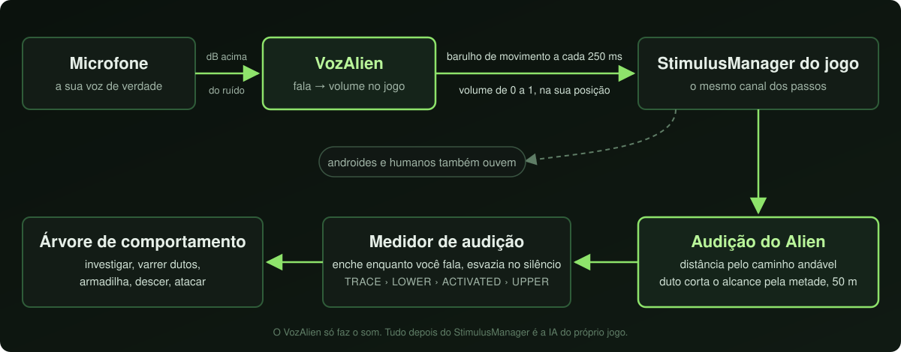

<h1 align="center">Como o Alien: Isolation te ouve</h1>

<p align="center">
  <b>Guia para contribuidores sobre os sistemas do jogo por trás do VozAlien</b><br>
  Engenharia reversa do <code>AI.exe</code> da Steam e das árvores de comportamento que vêm com o jogo.
</p>

<p align="center"><a href="REVERSE-ENGINEERING.md">🇺🇸 Read in English</a> · <a href="../README.pt-BR.md">Voltar ao README</a></p>

---

Este documento explica, passo a passo, como o jogo transforma um som numa reação do Alien e em que ponto exato
dessa cadeia o VozAlien se encaixa. Ele foi escrito para quem quer melhorar o mod, portar para outra versão do jogo
ou simplesmente entender o que está acontecendo. Não precisa ler o código antes: cada seção aponta a função
correspondente em [`src/voz_alien.c`](../src/voz_alien.c).

> [!NOTE]
> Tudo aqui saiu de análise estática do `AI.exe` da **Steam** (32 bits,
> SHA-256 `dde66521798aae8c39ed4e7a3400f561fcecfff83619d1426b9e0cedf5819a90`) e foi confirmado em jogo pelo log
> do mod. Outras versões (Epic, GOG, Microsoft Store) têm os mesmos sistemas em endereços diferentes.

## Sumário

1. [Visão geral](#1-visão-geral)
2. [Convenções](#2-convenções)
3. [Método: como achar as coisas sozinho](#3-método-como-achar-as-coisas-sozinho)
4. [Achando os personagens na memória](#4-achando-os-personagens-na-memória)
5. [O sistema de estímulos](#5-o-sistema-de-estímulos)
6. [Como um personagem ouve um estímulo](#6-como-um-personagem-ouve-um-estímulo)
7. [Dutos (backstage)](#7-dutos-backstage)
8. [O caminho forçado: NPC_FakeSense](#8-o-caminho-forçado-npc_fakesense)
9. [Árvores de comportamento: o que o Alien faz com isso](#9-árvores-de-comportamento-o-que-o-alien-faz-com-isso)
10. [Como o VozAlien junta tudo](#10-como-o-vozalien-junta-tudo)
11. [Segurança e outras versões do jogo](#11-segurança-e-outras-versões-do-jogo)
12. [Perguntas em aberto: boas primeiras contribuições](#12-perguntas-em-aberto-boas-primeiras-contribuições)
13. [Tabela de endereços](#13-tabela-de-endereços)
14. [Glossário](#14-glossário)

---

## 1. Visão geral

<p align="center">
  
</p>

O Alien: Isolation tem duas camadas independentes de IA:

| Camada | O que faz | Onde fica |
|---|---|---|
| **Sentidos** | Cada personagem com IA mantém um *medidor* por sentido (visão, sons de movimento, sons de combate…). Estímulos enchem os medidores; o tempo esvazia. | Código C++ no `AI.exe` |
| **Decisões** | Uma árvore de comportamento lê os medidores (e timers, flags, motivações) e escolhe uma ação: investigar, procurar, emboscar, atacar. | XML do Brainiac em `DATA/BEHAVIOR`, compilado em `DATA/BINARY_BEHAVIOR` |

Passos, rastreador e tiros nunca falam direto com a árvore de comportamento. Eles publicam um **estímulo** numa fila
global, e cada personagem decide sozinho se ouviu. O VozAlien faz exatamente o mesmo com a sua voz. É essa escolha
de projeto que faz o mod parecer parte do jogo.

## 2. Convenções

**Endereços.** A base de imagem preferida do executável é `0x400000`. Endereços escritos como `0x7A5310` são
*endereços virtuais* (VA), como aparecem no disassembler. Em execução a imagem é realocada (no Proton ela carrega em
`0x7A040000`), então o código precisa usar **RVAs**: `RVA = VA − 0x400000`, e depois `endereço real = base do
módulo + RVA`.

**Convenção de chamada.** Os métodos do jogo são `__thiscall` do MSVC: `this` em `ECX`, argumentos na pilha, e quem
é chamado limpa a pilha. `ret 0x1C` quer dizer que a função tira 0x1C bytes (sete argumentos de 4 bytes). No GCC
eles são declarados com `__attribute__((thiscall))`.

**Confiança.** Cada descoberta tem uma marca:

| Marca | Significado |
|---|---|
| ✅ | Confirmado lendo o disassembly (e, quando indicado, observado em jogo) |
| 🟨 | Provável: evidência forte, com alguma inferência |
| ❔ | Palpite: plausível, não verificado |

## 3. Método: como achar as coisas sozinho

Não precisa de ferramenta paga. Tudo neste documento foi achado com `objdump`, `strings`, um pouco de Python e os
próprios arquivos de dados do jogo.

**Desmonte uma vez, faça grep para sempre.**

```bash
objdump -d -M intel AI.exe > ai.asm          # ~5 milhões de linhas, sintaxe Intel
grep -n "call   0x4ab520" ai.asm               # quem chama uma função?
grep -n "0x16f0c88" ai.asm | head              # quem lê uma variável global?
```

**Converta posição no arquivo em endereço.** O `strings -t x` mostra a posição no arquivo. Converta com a tabela de
seções (`objdump -h AI.exe`):

| Seção | VA inicial | Posição inicial no arquivo | Conversão |
|---|---|---|---|
| `.text` | `0x401000` | `0x400` | `VA = posição + 0x400C00` |
| `.rdata` | `0x119F000` | `0xD9D600` | `VA = posição + 0x401A00` |
| `.data` | `0x1636000` | `0x1233C00` | `VA = posição + 0x402400` |

```bash
strings -t x -n 4 AI.exe | grep -w THRESHOLD_QUALIFIER   # posição f0c59c -> VA 0x130DF9C
grep -n "0x130df9c" ai.asm                                # código que usa essa string
```

**Siga os nomes.** O motor (CATHODE) registra enums e tipos de entidade pelo nome, então strings como
`NPC_FakeSense`, `UPPER_THRESHOLD` ou `CONDITION_IS_BACKSTAGE` levam direto ao código que as usa. Nomes de RTTI como
`.?AVNPC_FakeSense@CATHODE@@` identificam classes e suas vtables.

**Leia os dados.** A calibragem dos personagens fica em `DATA/CHR_INFO/ATTRIBUTES/*.BML` (XML binário: alcance de
audição, limiares, volume dos passos). A lógica de decisão do Alien vem em XML legível em `DATA/BEHAVIOR/`.

**Confirme em jogo.** A análise estática diz o que o código *pode* fazer; o log diz o que ele *fez*. Use
`LogLevel=2` e `Hotkeys=1` no `VozAlien.ini` para testes repetíveis (F7 e F8 simulam fala).

## 4. Achando os personagens na memória

Tudo começa num único ponteiro global, a **raiz do mundo**.

```c
uint8_t *world = *(uint8_t **)(base + 0x12F0C88);    // VA 0x16F0C88
uint8_t *chars = *(uint8_t **)(world + 0x08);        // gerenciador de personagens
// lista A: array em chars+0x80, quantidade em chars+0x84
// lista B: array em chars+0xD0, quantidade em chars+0xD4
```

| O quê | Onde | |
|---|---|---|
| Gerenciador de personagens | `*(world + 0x08)`; a função em `0x78A770` percorre a lista A e depois a B | ✅ |
| StimulusManager | `*(world + 0x18)` | ✅ |
| Classe do personagem | `*(int *)(*(uint8_t **)(chr + 0x64) + 4)`: 0 jogador, 1 Alien (lida em `0x5192D9`) | ✅ |
| Handle (id da entidade) | 8 bytes em `chr + 0x54` (`Character::GetHandle`, `0x77A2F0`) | ✅ |
| Posição | `vec3` em `chr + 0x70` | ✅ observado |
| Percepção (fila de eventos forçados) | `chr + 0x3BA8` | ✅ |
| Backstage (no duto) | `chr[0x2DA] \|\| chr[0x2DB]` (`Character::IsBackstage`, `0x77A350`) | ✅ observado |
| Bloco de atributos | `*(chr + 0x1154)`; o atributo de *id* N fica em `0x204 + N × 4` | ✅ |
| Relógio do jogo | `double` no VA `0x16410A8`, em segundos | ✅ |

O enum de classes segue a ordem do `CHARACTER_CLASS_COMBINATION` do motor: PLAYER, ALIEN, ANDROID, CIVILIAN,
SECURITY, FACEHUGGER, INNOCENT, ANDROID_HEAVY, MELEE_HUMAN.

> [!TIP]
> No VozAlien isso é a `scan_characters()`, que roda quatro vezes por segundo. Ela também guarda um **rastro** curto
> das posições recentes do jogador, usado depois para a imprecisão da posição.

## 5. O sistema de estímulos

### 5.1 O objeto estímulo

Um estímulo é um objeto pequeno. Existe uma versão básica (0x34 bytes, vtable `0x11C7190`) e uma estendida
(0x3C bytes, vtable `0x11C71B0`) com seis bytes de flags a mais. ✅

| Posição | Tipo | Significado |
|---|---|---|
| `+0x00` | ponteiro | vtable |
| `+0x04` | `u32[2]` | bits de "já processado", um por vaga de ouvinte |
| `+0x0C` | int | **tipo** (veja abaixo) |
| `+0x10` | u32 | carimbo de quadro escrito pelo gerenciador |
| `+0x14` | ponteiro | próximo estímulo do mesmo tipo |
| `+0x18` | vec3 | posição no mundo |
| `+0x24` | float | tempo de jogo |
| `+0x28` | `u32[2]` | handle da origem (quem fez o barulho) |
| `+0x30` | float | **volume**, de 0 a 1 na prática |
| `+0x34` | `u8[6]` | flags (só na estendida, veja §7) |
| `+0x3A` | u8 | flag extra (só na estendida, significado desconhecido) |

> [!IMPORTANT]
> Um estímulo do tipo 0 **precisa** ser a versão estendida. O tratador lê as flags em `+0x34` a `+0x36`; com o
> objeto básico, esses bytes são lixo de memória.

### 5.2 Tipos de estímulo

| Tipo | Significado | Quem gera | Alimenta |
|---|---|---|---|
| **0** | Barulho de movimento | Passos `0x7C71B0` (a cada 0,25 s, volume pelos `footstep_loudness_*`), bip do rastreador `0x682D90` (0,75 ou 1,0, até 20 por segundo), entrar/sair do duto `0x460D20` (0,4) 🟨 | HEARD_MOVEMENT |
| **1** | Som de arma | `Weapon_AINotifier` `0x578010` (1,0, ou 0,6 para um tipo de arma) e outros códigos de arma | HEARD_COMBAT |
| **2** | Evento de proximidade ("scanner") | `0x5781A0` | um nível de movimento forçado dentro de um raio 2D |
| **3 a 5** | Não tratados por personagem | o tipo 4 é impacto de bala, usado pelos esquadrões humanos | |
| **6** | Dica "o jogador passou aqui" | a entidade `Door`, `0x4E30E0` | grava a última posição conhecida do jogador direto na memória de cada NPC, sem medidor |

Para comparar: o volume dos passos do jogador vai de **0,2** (devagar) a **0,6** (correndo), tirado direto de
`DATA/CHR_INFO/ATTRIBUTES/THE_PLAYER.BML`. O VozAlien coloca a sua voz nessa mesma régua.

### 5.3 Publicando um estímulo

```c
typedef void *(THISCALL *stim_ctor_t)(void *self, int type, const float *pos, float time,
                                      const void *handle, float loudness, const uint8_t *flags6, int extra);
typedef void  (THISCALL *stim_add_t)(void *mgr, const void *stim, int replaceSameType);

uint8_t stim[0x40];
static const uint8_t flags[6] = {0};
ctor(stim, 0, &pos.x, (float)*gameClock, player + 0x54, loudness, flags, 0);   // VA 0x4468B0, ret 0x1C
add(stimulusManager, stim, 0);                                                    // VA 0x4574D0, ret 0x08
```

* O `AddExtended` copia o objeto para um nó do pool, carimba e coloca na lista do tipo dele, então o seu buffer pode
  ficar na pilha. ✅
* `replaceSameType = 1` apagaria **todos** os estímulos daquele tipo na fila antes. O jogo sempre passa 0. ✅
* As variantes básicas são `0x446850` (construtor, ret 0x14) e `0x5772F0` (adicionar). ✅

### 5.4 Tempo de vida e o tick

O `StimulusManager::Tick` (`0x7A5310`, thiscall, sem argumentos) avança o contador de quadros do gerenciador e
apaga todo estímulo com dois ou mais ticks de idade. Assim, cada ouvinte vê cada estímulo exatamente uma vez. ✅

O tick é chamado de um único lugar, `0x7B41A3`, e só enquanto o mundo está simulando
(`([[0x16F194C] + 4] & 0x179FF) == 0`), não com o jogo pausado ou carregando. 🟨 Isso faz dessa chamada o gancho
ideal: o VozAlien desvia a chamada, chama a função original e depois publica o próprio estímulo.

## 6. Como um personagem ouve um estímulo

### 6.1 Quem pode ouvir

Cada personagem com IA tem um *Brain* (montado em `0x733850`). Em `brain + 0xF4` fica o **SenseProcessor** dele
(0xC8 bytes, construtor `0x72D7B0`), que tem um ouvinte de estímulos embutido em `+0x5C`. Na inicialização o ouvinte
se registra no gerenciador (`0x6EC240`, uma de 56 vagas) para os tipos 0, 1, 2 e 6. ✅

A cada quadro: `Brain::Update` (`0x7342A0`) chama `SenseProcessor::Update` (`0x7325E0`), que chama
`StimulusManager::Dispatch` (`0x6D8FB0`). O Dispatch entrega cada estímulo novo para o `OnStimulus` (`0x730C30`).
**Não existe filtro por distância antes disso**: todo ouvinte avalia todo estímulo. ✅

### 6.2 Os filtros do `OnStimulus`

Antes de qualquer conta, o estímulo é descartado quando: ✅

* o handle da origem não aponta para uma entidade viva, ou a origem é o próprio ouvinte;
* a origem não é hostil ou relevante para o ouvinte (tabela de facções em `[world + 0x34]`). É por isso que
  personagens aliados te ignoram;
* (só no tipo 0) uma das flags manda descartar, ou o ouvinte é um Alien no duto e a origem não é o jogador (§7).

### 6.3 Distância e ativação

O `Hearing::Activation` (`0x6D7CD0`, `ecx = ouvinte + 0x33E0`) calcula a ativação bruta: ✅

```
maxD = GetMaxHearingDistance(ouvinte)          // 0x775F10, depende do conjunto de sentidos atual, mínimo 5 m
d    = comprimento do caminho pela navmesh     // nunca menor que a distância em linha reta
       (linha reta x 2 se o ouvinte ou a origem estiver no duto)
raw  = max(0, volume - d / maxD)
```

Ou seja, volume **1,0 é ouvido até `maxD`** e cai de forma linear. Para o Alien, `maxD` é **50 m** em todos os
conjuntos de sentidos (`ALIEN.BML` e `DEFAULTS.BML`). Se a busca de caminho falha, vale a linha reta; um alvo
inalcançável não é ouvido. 🟨

### 6.4 Enchendo o medidor

Depois, `raw` é escalado por ouvinte (`0x6FB2E0`): ✅

```
scaled = (min_raw + raw * (max_raw - min_raw)) * activation_scalar
```

e somado ao medidor HEARD_MOVEMENT do registro de memória do ouvinte para aquela origem (`0x729120`):
`act = min(1, act + scaled)`. Cada limiar que o medidor passa guarda a posição **exata** do estímulo e o tempo, e
avisa o personagem. ✅

Os valores do Alien (o conjunto 1 é o "normal"; a variante aguçada vale enquanto ele está alerta):

| Atributo | Valor | Fonte |
|---|---|---|
| `max_hearing_distance` | 50 m | `DEFAULTS.BML`, `ALIEN.BML` |
| `movement_sound_activation_scalar` | 0,7 normal, 1,25 aguçado, 0,3 conjunto 2, 2,5 conjunto 3 | `ALIEN.BML` |
| `movement_sound_trace / lower / activation / upper_threshold` | 0,05 / 0,375 / 0,75 / 0,875 | `DEFAULTS.BML` |
| `movement_sound_decay_per_second` | 0,05 | `DEFAULTS.BML` |

**Exemplo com números.** Você fala com volume 0,24 e o Alien está a 3,7 m, no conjunto normal:
`raw = 0,24 − 3,7/50 ≈ 0,17`, então `scaled ≈ 0,17 × 0,7 ≈ 0,12` por estímulo. Cinco estímulos (cerca de 1,25 s de
fala) levam o medidor a uns 0,6: passa do LOWER e não chega no ACTIVATED. O Alien vai conferir de onde veio o
barulho, que foi exatamente o que vimos em jogo.

> [!NOTE]
> Ainda não foi achado onde `decay_per_second` e `positional_accuracy_scalar` são aplicados (§12). A posição
> guardada é exata, então a imprecisão provavelmente entra depois, quando o Alien escolhe um ponto para procurar.

## 7. Dutos (backstage)

O jogo chama a rede de dutos de **backstage**. O estado de um personagem são dois bytes: `0x2DA` (dentro) e `0x2DB`
(entrando). `0x77A350` devolve qualquer um dos dois; o nó `ConditionIsBackstage` da árvore de comportamento chama
exatamente essa função. ✅

Como o duto muda a audição (tipo 0, tudo ✅):

| Situação | Distância usada |
|---|---|
| Ninguém no duto | Comprimento do caminho pela navmesh |
| Ouvinte **ou** origem no duto | Linha reta × 2 (o som alcança metade da distância) |
| Ouvinte Alien, origem jogador, flag `+0x35` ligada | Linha reta × 1 (sem penalidade do duto) |

A flag `+0x34` faz o som ser **inaudível para um Alien no duto**. O rastreador liga essa flag, e é por isso que o
Alien nos dutos não ouve o seu rastreador. Um Alien no duto também ignora barulho de movimento de qualquer um que
não seja o jogador. O VozAlien publica todas as flags zeradas, o que dá o comportamento natural do duto.

> [!TIP]
> As strings `ALIEN_HEARD_BACKSTAGE` e `HEARD_BS_ALIEN` parecem importantes, mas são enums de diálogo e de grupo:
> NPCs humanos reagindo a ouvir o Alien nos dutos. Não são entrada para a audição do Alien. 🟨

## 8. O caminho forçado: NPC_FakeSense

Os scripts das fases às vezes precisam que o Alien "perceba" algo de qualquer jeito. Para isso o motor tem a
entidade CATHODE `NPC_FakeSense` (parâmetros `SensedObject`, `FakePosition`, `Sense`, `ForceThreshold`). ✅

* O tratador, perto de `0x4E3540`, faz um switch no `SENSORY_TYPE` de 0 a 4 e monta os tipos 9 a 13 (VISUAL 9,
  WEAPON_SOUND 10, **MOVEMENT_SOUND 11**, DAMAGE_CAUSED 12, TOUCHED 13).
* Construtor do evento `0x4AB520` (ret 0x24): `(kind, handle.lo, handle.hi, pos*, 1.0f, 0, threshold, time, 0.03125f)`.
* Ele é entregue pelo `EnqueueSenseEvent` (`0x4E1C20`, `this = chr + 0x3BA8`), direto na percepção de **um**
  personagem.
* Valores dos limiares (nome para valor em `0x6C70DE`): **TRACE 0, LOWER 1, ACTIVATED 2, UPPER 3**.

Esse caminho pula distância, alcance de audição, dutos e o medidor. O mod original AlienIsolationVoiceRestore usa
ele com limiar UPPER e a posição exata do jogador em toda fala, e é por isso que parece um ping. O VozAlien mantém
uma versão graduada como reserva (`Modo=forcado`), mas o padrão é o caminho natural dos estímulos.

## 9. Árvores de comportamento: o que o Alien faz com isso

Abra o `DATA/BEHAVIOR/ALIEN_BEHAVE.XML` em qualquer editor. A raiz é um seletor por prioridade que escolhe um ramo
pela **motivação**; as motivações são calculadas no código a partir dos medidores e timers. As condições leem os
medidores direto:

```xml
<Node Class="LegendPlugin.Nodes.ConditionIsSenseActivationAbove"
      MustBeTriggered="True" SenseType="HEARD_MOVEMENT:3" ThresholdQualifier="LOWER_THRESHOLD:1">
```

Os ramos que importam para um mod de voz:

| Arquivo | Quando | O que acontece |
|---|---|---|
| `ALIEN_SUSPECT_TARGET_RESPONSE.XML` | Um sentido acabou de passar do **LOWER**, o Alien **não** está no duto, e já se passaram 30 s desde a última vez | `ActionSuspectTargetResponse`: vai conferir a posição percebida |
| `ALIEN_THREAT_AWARE.XML` | O jogador está com uma arma que o Alien respeita (o lança-chamas) | Mantém distância, chega com cuidado, pode flanquear por um duto |
| `ALIEN_BACKSTAGE_STALK.XML` | O Alien está nos dutos | `ActionBackstageAreaSweep` (BACKSTAGE_ONLY, ou ALLOW_KILLTRAP para a armadilha com a baba) |
| `ALIEN_IN_VENT.XML`, `ALIEN_BREAKOUT.XML` | O jogador ou o Alien está num duto | Ataques no duto; `SHOULD_BREAKOUT` faz ele descer do duto |

O ponto principal para quem for contribuir: **um estímulo nunca força uma ação.** Ele só alimenta os medidores, e a
árvore continua com todas as opções que tinha (emboscada, armadilha, recuar). O VozAlien foi feito para preservar
isso.

## 10. Como o VozAlien junta tudo

| Etapa | Função em `src/voz_alien.c` | O que faz |
|---|---|---|
| Carga | `DllMain`, depois `install()` | Lê o `VozAlien.ini`, confere cada endereço byte a byte, desvia a chamada em `0x7B41A3` para o `tick_hook` |
| Microfone | `mic_thread()` | `waveIn` a 16 kHz; calibração do ruído do quarto (percentil 30 em 3 s); ruído de fundo adaptativo; detecção de fala com ataque e soltura; detecção de microfone mudo; um *pacote de voz* a cada 250 ms de fala |
| Tick do jogo | `tick_hook()`, depois `game_tick()` | Roda dentro do `StimulusManager::Tick`, na thread do jogo, só com a IA simulando |
| Estado do mundo | `scan_characters()`, `trail_update()` | Jogador, Aliens, flags de duto, rastro recente |
| Som | `post_voice()` | `volume = 0,30 × 2^((dB − 20) / 6)`, limitado a 1,0; escolhe a posição; publica um estímulo estendido do tipo 0 |
| Imprecisão | `fuzz_point()` | Alien a mais de 8 m (× 2 no duto): um ponto do rastro a 30 % da distância (no máximo 15 m), nunca mais perto do Alien do que você |
| Reserva | `forced_eval()` | Eventos NPC_FakeSense graduados (`Modo=forcado`) |

Por que dobrar o volume a cada 6 dB? A pressão sonora cai uns 6 dB cada vez que a distância dobra, e a audibilidade
do jogo é linear na distância (`volume − d/50`). Dobrar o volume a cada 6 dB faz "de quão longe você é ouvido" se
comportar como som de verdade.

## 11. Segurança e outras versões do jogo

O `install()` se recusa a alterar qualquer coisa se algum destes não bater (`??` marca bytes de endereço realocado):

| Nome | RVA | Bytes esperados |
|---|---|---|
| Construtor ExtStimulus | `0x0468B0` | `8B C1 8B 4C 24 04 66 0F EF C0 66 0F D6 40 04 89 48 0C` |
| AddExtended | `0x0574D0` | `6A FF 68 ?? ?? ?? ?? 64 A1 00 00 00 00 50 64 89 25 00 00 00 00 83 EC 3C 8B 44 24 4C 56 8B F1` |
| StimulusManager::Tick | `0x3A5310` | `83 EC 0C FF 41 20 53 55 8D 41 04` |
| Chamada do tick | `0x3B419E` | `8B 49 18 56 57 E8` (e a chamada precisa ainda apontar para o tick) |
| Construtor FakeSense | `0x0AB520` | `8B 54 24 04 8B C1 F3 0F 10 44 24 14 33 C9 89 48 04` |
| EnqueueSenseEvent | `0x0E1C20` | `6A FF 68 ?? ?? ?? ?? 64 A1 00 00 00 00 50 64 89 25 00 00 00 00 83 EC 3C` |
| Leitura de personagens | `0x38A770` | `A1 ?? ?? ?? ?? 8B 48 08 8B 91 84 00 00 00 8B 44 24 04 3B C2` |

**Portar para Epic ou GOG** é achar as mesmas funções naquele executável. Procure esses padrões de bytes (eles não
têm endereço absoluto fora das partes `??`), confirme cada achado pelos lugares que o chamam e troque as RVAs. As
posições dentro das estruturas (`+0x54`, `+0x70`, `+0x2DA`, `+0x3BA8`) muito provavelmente são as mesmas entre
versões. Um pull request com uma tabela de versões, escolhida pelo hash do executável, seria muito bem-vindo.

## 12. Perguntas em aberto: boas primeiras contribuições

* **Decaimento e precisão da posição.** Onde `decay_per_second` e `positional_accuracy_scalar` são aplicados? Se o
  jogo já borra o ponto de busca, a camada de imprecisão do VozAlien poderia ser reduzida ou virar opcional.
* **Como a varredura dos dutos escolhe o alvo.** `BackstageAreaSweep` (fábrica em `0x6ED630`) e
  `BackstageAlienResponse` (`0x6F6CA0`) escolhem para onde o Alien vai nos dutos. Conhecer as entradas deles deixaria
  prever com precisão o comportamento "duto longe versus duto perto".
* **Esconderijo.** `hiding_hearing_range` (atributo `0x207`) provavelmente reduz o quanto um jogador escondido é
  ouvido. Dá para ler se o jogador está escondido? Falar de dentro do armário deveria soar mais baixo?
* **Uma sobreposição de depuração.** Ler o medidor HEARD_MOVEMENT do Alien para o jogador deixaria a calibragem
  muito mais fácil do que observar o comportamento.
* **Mais versões do jogo.** Veja §11.
* **Chaves do INI em inglês.** Seções e chaves ainda estão em português (`[Voz]`, `[Imprecisao]`); uma troca
  compatível com os arquivos antigos ajudaria quem é de fora.

## 13. Tabela de endereços

Todos os valores são VAs (subtraia `0x400000` para ter as RVAs).

| VA | Nome | Observações | |
|---|---|---|---|
| `0x16F0C88` | Raiz do mundo (global) | `+0x08` personagens, `+0x18` StimulusManager, `+0x34` facções | ✅ |
| `0x78A770` | Leitura de personagens | listas em `+0x80/+0x84` e `+0xD0/+0xD4` | ✅ |
| `0x77A2F0` | `Character::GetHandle` | `lea eax, [ecx+0x54]` | ✅ |
| `0x77A350` | `Character::IsBackstage` | `[0x2DA] \|\| [0x2DB]` | ✅ |
| `0x78B140` | `Character::SetBackstage` | grava `0x2DA` e `0x2D9` | ✅ |
| `0x16410A8` | Relógio do jogo | `double`, segundos | ✅ |
| `0x4468B0` | Construtor `ExtStimulus` | ret 0x1C | ✅ |
| `0x446850` | Construtor `BaseStimulus` | ret 0x14 | ✅ |
| `0x4574D0` | `StimulusManager::AddExtended` | ret 0x08 | ✅ |
| `0x5772F0` | `StimulusManager::AddBase` | ret 0x08 | ✅ |
| `0x7A5310` | `StimulusManager::Tick` | apaga estímulos depois de 2 ticks | ✅ |
| `0x7B41A3` | Chamada do tick | ponto de gancho do VozAlien | ✅ |
| `0x6EC240` | `StimulusManager::RegisterListener` | 56 vagas | ✅ |
| `0x6D8FB0` | `StimulusManager::Dispatch` | tipos 0 a 6 | ✅ |
| `0x730C30` | `SenseProcessor::OnStimulus` | filtros e modo de distância | ✅ |
| `0x6D7CD0` | `Hearing::Activation` | `max(0, volume − d/maxD)` | ✅ |
| `0x775F10` | `Character::GetMaxHearingDistance` | por conjunto de sentidos, mínimo 5 m | ✅ |
| `0x6FB2E0` | `SenseSlot::Scale` | min/max raw, activation scalar | ✅ |
| `0x729120` | `SenseSlot::Add` | medidor, limiares, posição guardada | ✅ |
| `0x7C71B0` | Passos | gera tipo 0 | ✅ |
| `0x682D90` | Bip do rastreador | gera tipo 0, flags `{1,0,0,0,0,0}` | ✅ |
| `0x578010` | `Weapon_AINotifier` | gera tipo 1 | ✅ |
| `0x4E30E0` | `Door` "o jogador passou aqui" | gera tipo 6 | ✅ |
| `0x4AB520` | Construtor do evento forçado | NPC_FakeSense | ✅ |
| `0x4E1C20` | `EnqueueSenseEvent` | `this = chr + 0x3BA8` | ✅ |
| `0x6C70DE` | Nome do limiar para valor | TRACE 0 a UPPER 3 | ✅ |
| `0x774FA0` | Tarefa `START_NEXT_FRAME` | gancho alternativo por quadro | ✅ |
| `0x12B4B00` | vtable do gerenciador de ameaça | não roteia sons | 🟨 |
| `0x6ED630` | Fábrica do `BackstageAreaSweep` | escolha do alvo não rastreada | ❔ |

## 14. Glossário

| Termo | Significado |
|---|---|
| **VA / RVA** | Endereço no disassembler / distância a partir da base do módulo, que é o que o código usa em execução |
| **thiscall** | Convenção de métodos do MSVC: `this` em ECX, quem é chamado limpa a pilha |
| **Estímulo** | Um barulho ou evento publicado no StimulusManager para todo ouvinte avaliar |
| **Sentido / medidor** | Acumulador por personagem para um tipo de percepção, de 0 a 1, que esvazia com o tempo |
| **Conjunto de sentidos** | O perfil de audição e visão do personagem (normal, aguçado…), que muda escalas e alcances |
| **Limiar** | TRACE, LOWER, ACTIVATED, UPPER: níveis do medidor que disparam comportamentos |
| **Backstage** | A rede de dutos, e o estado de estar dentro dela |
| **Motivação** | O que está guiando a árvore de comportamento no momento (espreitar, atacar, investigar…) |
| **Killtrap** | O Alien esperando em cima de uma saída de duto para agarrar o jogador (a "armadilha com a baba") |
| **ASI** | Uma DLL renomeada para `.asi` que um ASI loader injeta no jogo ao abrir |

---

<p align="center"><sub>Achou um erro ou um endereço novo? Abra uma issue ou um pull request e inclua o seu <code>VozAlien.log</code> e como você confirmou.</sub></p>
